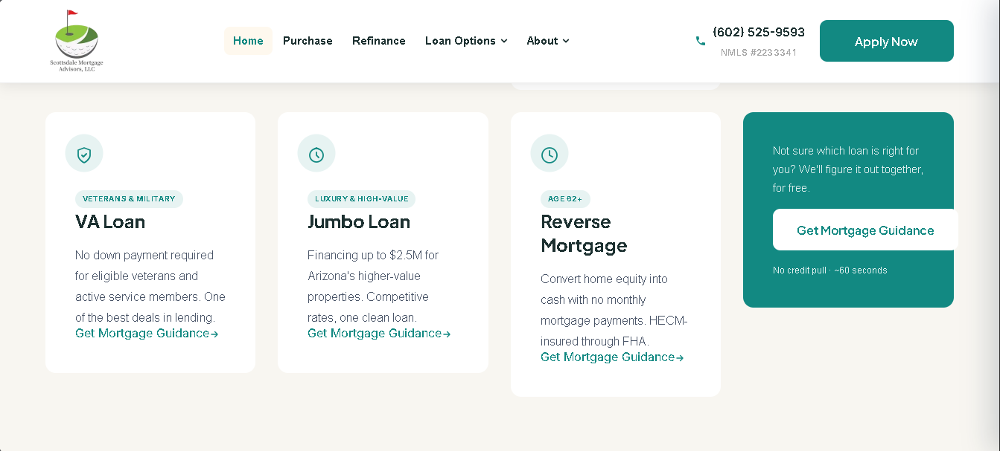
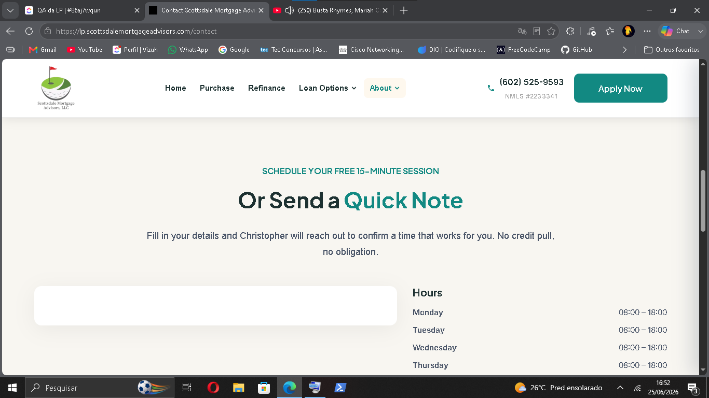
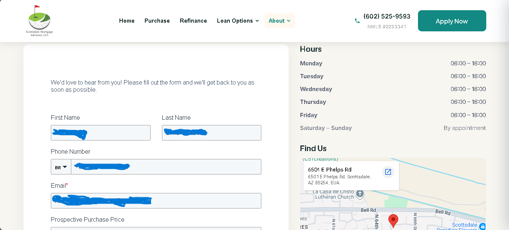

# 🔍 Case de QA e Usabilidade — VIZUH (`lp.scottsdalemortgageadvisors.com`)

> **Contexto do Estudo de Caso:** Relatório técnico de Quality Assurance (QA), testes exploratórios e validação de interface realizados no escopo de entregas da **VIZUH**. O foco foi identificar falhas de layout e inconsistências de renderização em rotas de contato na landing page da **Scottsdale Mortgage Advisors**, registrando o estado verificado durante a auditoria.

## 🎯 Objetivo da Auditoria

Mapear problemas de interface e comportamento de componentes durante a navegação na landing page da **Scottsdale Mortgage Advisors**, garantindo maior estabilidade visual e confiabilidade no fluxo de captura de leads.

## 🛠️ Metodologia e Escopo

* **Contexto Profissional:** Atuação contínua em colaboração técnica / QA na **VIZUH**.

* **Abordagem:** Testes exploratórios, inspeção visual em navegador (Desktop/Mobile) e testes de fluxo de navegação.

* **Áreas Avaliadas:**

  * Responsividade, *padding* e contenção de elementos em cards no *desktop*.

  * Renderização e persistência/remontagem do formulário na rota `/contact`.

## 📋 Registro de Bugs & Cenários de Teste

| ID | Módulo / Funcionalidade | Severidade Sugerida | Dispositivo | Status | Descrição do Problema | Comportamento Esperado | 
| ----- | ----- | ----- | ----- | ----- | ----- | ----- | 
| **BUG-01** | Responsividade & Layout (Card CTA) | Média | Desktop | Reportado / Em andamento | Na verificação visual, o botão **"Get Mortgage Guidance"** ultrapassa a borda direita do card verde, com ajustes de *padding*/*posicionamento* registrados no desktop. | O botão e demais elementos devem permanecer contidos dentro dos limites do card com *padding* e alinhamento consistentes. | 
| **BUG-02** | Carregamento do Formulário (`/contact`) | Alta | Desktop e Mobile | Reportado / Em andamento | Ao navegar/retornar para páginas onde o formulário deveria estar presente (ex: seção *Contact Us* / `/contact`), o componente não é renderizado em alguns momentos (exibindo área em branco). | O formulário deve ser montado e exibido de forma consistente sempre que o usuário acessar ou retornar à rota/seção de contato. | 

## 📸 Evidências Visuais

* **BUG-01 — Responsividade e Sobreposição no Card CTA (Desktop):**
  

* **BUG-02 — Falha de Renderização vs. Estado Normal do Formulário (`/contact`):**
  
  

## 🧪 Cenários de Teste (Casos Executados)

* **CT-01 (Layout & Overflow):** Verificar em resolução desktop se o CTA principal do bloco lateral respeita a largura do contêiner sem *overflow* visual.

* **CT-02 (Navegação & Montagem de Componente):** Acessar a seção/página de contato, sair e retornar para validar se o formulário é renderizado integralmente.

## 🔄 Ciclo de Vida do Bug (Feedback Loop)

1. **Identificação:** Execução de testes exploratórios e registro das falhas visuais e de renderização conforme o comportamento observado na tela.

2. **Documentação e Reporte:** Consolidação das evidências e descrição técnica para o time de desenvolvimento da **VIZUH** (status atual: *Reportado / Em andamento*).

3. **Reteste e Homologação:** Validação das alterações de layout e ciclo de vida do componente de formulário caso novas versões sejam publicadas para homologação.

## 🔧 Recomendações Técnicas

* **UI / CSS:** Revisar largura, *box-sizing* e margens/paddings do botão e do card contêiner caso seja necessário evitar transbordo horizontal.

* **Front-end / Estado:** Investigar o ciclo de montagem/hidratação ou condições de renderização do componente de formulário ao navegar entre rotas/estados.

## 👩‍💻 Autoria

**Karen Laís Lima Gualberto** — Engenharia de Software | Quality Assurance (QA).